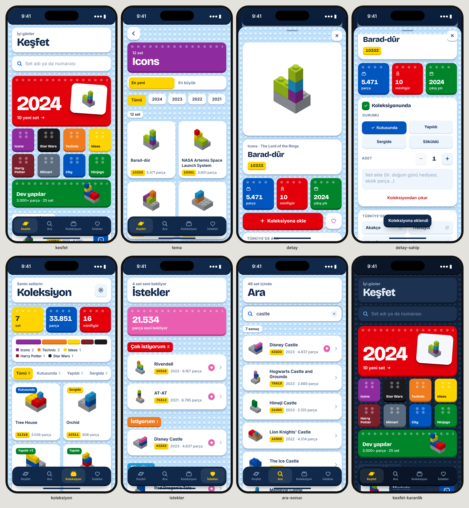

# Plüton

LEGO koleksiyonunu ve istek listesini tutan, iPhone ve Mac'e kurulabilen bir web uygulaması (PWA).
Arayüz "Plaka" fikri üzerine kurulu: zemin bir LEGO plakası, üstündeki her şey bir tuğla.

**Adres:** https://tahatas013.github.io/pluton/



## Kurulum

- **iPhone:** Safari'de adresi aç → Paylaş → **Ana Ekrana Ekle**
- **Mac:** Safari'de aç → Dosya → **Dock'a Ekle**

Kurduktan sonra uygulama internetsiz de açılır; bakılan set görselleri önbellekte kalır.

## Neler var

- **Keşfet:** yılın yeni setleri, temalar, 3.000+ parçalık dev yapılar, "şansına bir set"
- **Ara:** set adı ya da kutudaki numarayla arama
- **Koleksiyon:** durum (kutusunda / yapıldı / sergide / söküldü), adet, not; toplam parça ve minifigür
- **İstekler:** üç öncelik seviyesi; alınca tek dokunuşla koleksiyona taşınır
- **Türkiye durumu:** her set için resmi Türkiye mağazası [lego.tr](https://lego.tr)'deki fiyat ve stok;
  Türkiye'de olmayan yeni setler "Yalnızca yurt dışında", henüz çıkmamışlar "Yakında" olarak işaretlenir
- **Set sayfası:** parça ve minifigür sayısı, Türkçe ad, lego.tr / LEGO.com bağlantısı, Türk mağazalarında
  (Akakçe, Trendyol, Hepsiburada, Amazon) set numarasıyla arama, montaj talimatları
- **Yedek:** veriler cihazda tutulur; Ayarlar'dan yedek alıp AirDrop ile diğer cihaza aktarılabilir

## Güncelleme (otomatik)

Her sabah 07:23'te (TSİ) GitHub Actions şunları yapar ve siteyi yeniden yayınlar:

1. `scripts/fetch-lego-tr.mjs` — lego.tr'deki her ürünün fiyatını ve stok durumunu okur
   (robots.txt'ye uygun, kendini tanıtan bir User-Agent ile, en fazla 2 eşzamanlı istek).
   Site o gün okunamazsa bir önceki günün verisi kullanılır.
2. `scripts/build-catalog.mjs` — Rebrickable'ın güncel set listesini indirir ve lego.tr verisiyle birleştirir.
   lego.tr'de olup listede olmayan ürünler (çok yeni setler, aksesuarlar) de eklenir.

Uygulama kataloğu her açılışta internetten tazeler; internet yoksa son indirilen kataloğu kullanır.
Elle güncellemek için: GitHub'da **Actions → Yayınla → Run workflow**. Saati değiştirmek için
`.github/workflows/yayinla.yml` içindeki `cron` satırı (saatler UTC'dir).

## Nasıl çalışıyor

- Vite + React + TypeScript, animasyonlar için Motion, veriler IndexedDB'de
- Katalog ve Türkiye verisi derleme sırasında üretilir, depoya yazılmaz

## Geliştirme

```bash
npm install
npm run catalog      # Rebrickable'dan güncel kataloğu indirir
npm run dev          # http://localhost:5173/pluton/
```

Rebrickable'a erişilemeyen bir ortamda `npm run catalog:dev` küçük bir örnek katalog yazar.
İkonlar `scripts/icon.svg` dosyasından `npm run icons` ile üretilir.

Set verileri ve görselleri [Rebrickable](https://rebrickable.com)'dan gelir.
LEGO®, LEGO Group'un ticari markasıdır; bu uygulama LEGO Group ile bağlantılı değildir.
